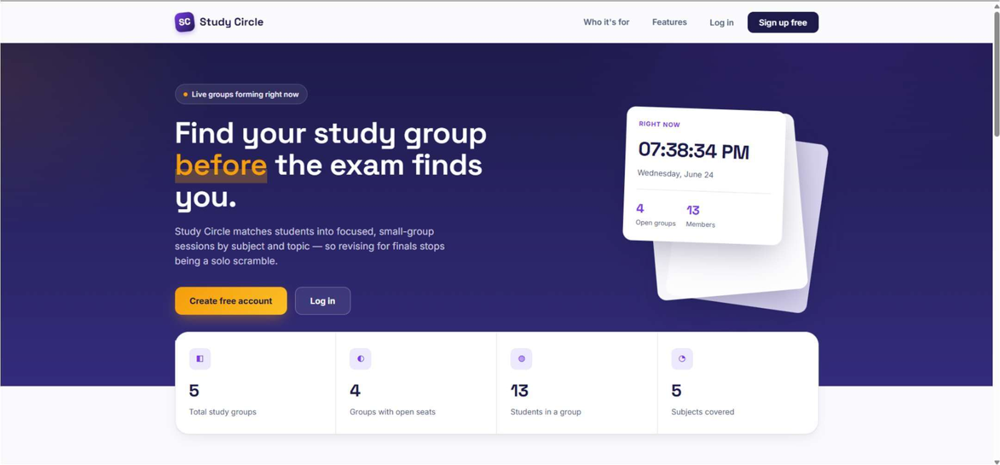
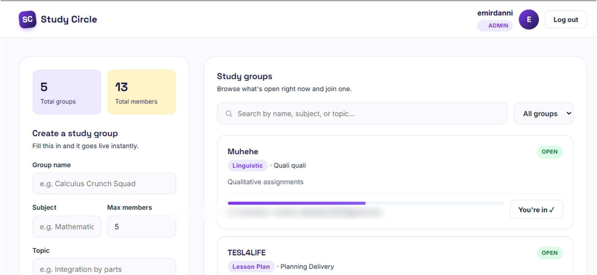
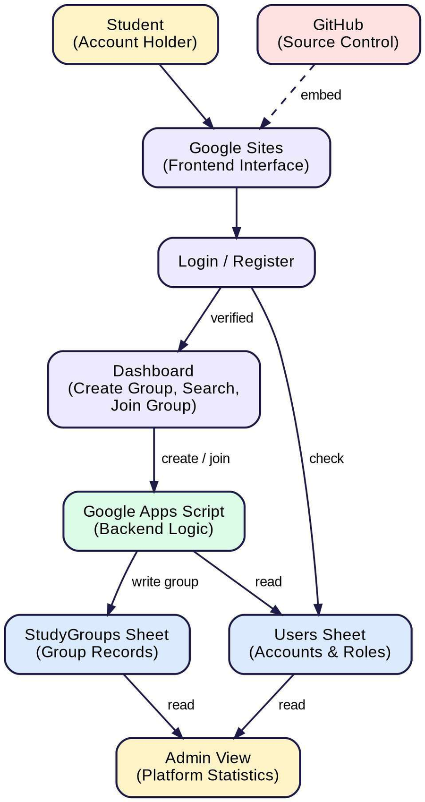

# Smart Study Circle Finder

A web app that helps students find, create and join study groups on campus.

**Live demo:** [sites.google.com/view/smart-study-circle-finder](https://sites.google.com/view/smart-study-circle-finder/home)

---

## Problem

Students form study groups through scattered group chats and social media posts. There's no single place to see which groups exist, what subject they cover, or whether they still have space.

## Features

- **Register and log in** with role-based access (Student, Admin, Viewer)
- **Browse a live directory** of study groups
- **Search and filter** by subject or topic
- **Create a group** with a subject, topic and member limit
- **Join with one click**, with member capacity checked automatically
- **Admin view** of all groups, users and platform stats
- **Viewer mode** to browse without an account

## How It Works

1. Google Sites hosts the front end and embeds the web app
2. Google Apps Script handles the logic (login, create, join, search)
3. Google Sheets stores users and study groups as a simple database

## Tech Stack

- Google Apps Script (JavaScript)
- HTML / CSS
- Google Sheets (database)
- Google Sites (hosting)
- Git / GitHub (version control)

## Files

- `index.html`: landing page that opens the deployed Apps Script web app (set `APP_URL` to your own `/exec` URL)

## Development Process

- Requirement analysis and use cases
- System modelling and design
- Iterative prototype development
- Test cases for each main function

## Project Info

- **Course:** Software Engineering, Politeknik Ungku Omar (Session II 2025/2026)

## Future Improvements

- Stronger account security
- Leave-group function and meeting scheduling
- Group recommendations based on enrolled courses
